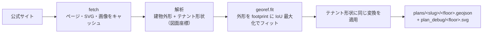
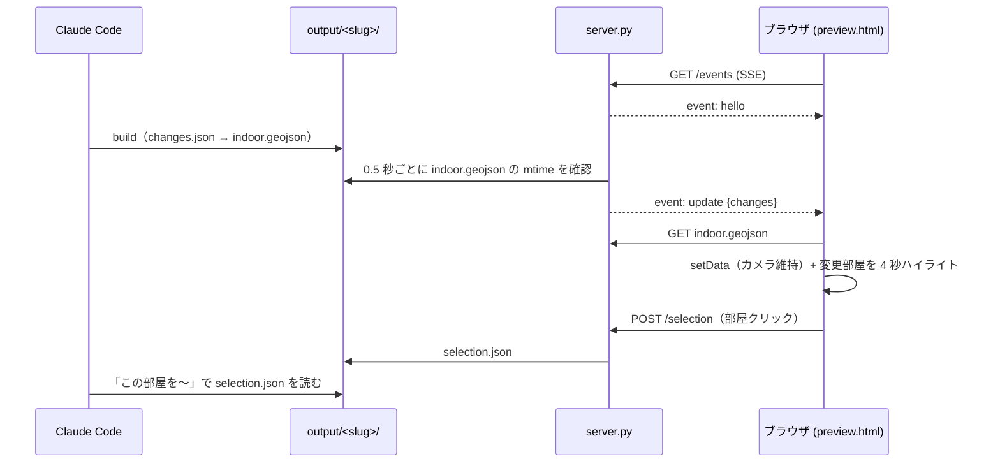

# アーキテクチャ

indoor-generator は、実在する建物の屋内マップ（Mapbox の indoor データモデルに沿った GeoJSON:
`facility` > `structure` > `floor` > `room`）を自然言語のリクエストから生成し、会話を通じて改善していくためのツールです。
生成物は GL JS（Standard スタイル + `IndoorControl`）でプレビューでき、依頼があれば 1 つの Mapbox タイルセットとして公開できます。

役割は大きく 2 つに分かれます。

| 層 | 担当 | 性質 |
|---|---|---|
| **エージェント層**（Claude Code + `.claude/skills/` のスキル） | 建物の特定、Web 調査、config の記述・編集、フロアマップ画像の位置合わせ・トレース、ユーザーとの対話 | 非決定的・判断を伴う |
| **パイプライン層**（`main.py` + `indoor_gen/`） | footprint 取得、config 検証、面積分割、GeoJSON / プレビュー生成、品質・コスト集計、タイルセット公開、ライブ配信 | 決定的・再現可能 |

両者の境界は **`configs/<slug>.json`**（建物 config）です。エージェントは config だけを書き、
パイプラインは config から出力を一意に生成します。`output/**/indoor.geojson` を直接編集することはありません。

## 全体フロー

```mermaid
flowchart LR
    U[ユーザー<br/>自然言語の指示] --> A[Claude Code<br/>indoor-map スキル]
    A -- locate / parts --> OSM[(OSM<br/>Nominatim / Overpass / OSM API)]
    A -- WebSearch / WebFetch --> WEB[(公式フロアガイド等)]
    A -- import-floorguide<br/>import-imagemap<br/>basemap / trace --> PLAN[configs/plans/&lt;slug&gt;/*.geojson]
    A -- 書く・編集する --> CFG[configs/&lt;slug&gt;.json]
    CFG --> B[main.py build]
    PLAN --> B
    OSM --> B
    B --> OUT[output/&lt;slug&gt;/<br/>indoor.geojson, index.html, changes.json,<br/>quality.json, cost.json]
    B --> H[configs/.history/&lt;slug&gt;/]
    OUT --> S[main.py serve<br/>SSE ライブリロード]
    S --> BR[ブラウザ<br/>GL JS プレビュー]
    BR -- 部屋クリック --> SEL[output/&lt;slug&gt;/selection.json]
    BR -- 対応点を保存 --> AL[output/&lt;slug&gt;/alignment.json]
    SEL --> A
    AL -- align --apply --> CFG
    OUT -- publish（依頼時のみ）--> TS[(Mapbox タイルセット<br/>indoor-dev / indoor)]
```

1. **初回生成**: 建物名 → `locate` で OSM footprint を特定 → Web 調査 →（可能なら）公式フロアマップを plan GeoJSON に取り込み（importer、または画像の `basemap` + `align` + `trace`）→ config を書く → `validate` → `build` → `serve`
2. **編集ループ**: 「この部屋を会議室に」などの指示 → `selection.json` や config から対象を特定 → config を編集 → `build` → プレビューが自動更新し、変更された部屋がハイライトされる
3. **Undo**: `undo` が履歴スナップショットを config に書き戻して再ビルドする
4. **品質確認**: `report` で部屋ごとの根拠（traced / listed / estimated / derived）を見て、弱い部屋を調べ直す。`compare` でモデル別のビルドを比較、`cost` で Claude の利用コストを確認
5. **公開**: ユーザーが求めたときだけ `publish`（既定はドライラン、`--upload` で実行）

エージェント側の手順はスキルに分かれています。

| スキル | 内容 |
|---|---|
| `indoor-map`（`SKILL.md`, `config_guide.md`） | 作成・編集の本体。config の書き方と自然言語→編集の対応表 |
| `indoor-floor-image` | フロアマップ画像の重ね合わせ・位置合わせ・トレース |
| `indoor-importer` | 新しいフロアガイドサイト用 importer の追加 |
| `indoor-quality` | 出典の弱い部屋の調査、`report` / `compare` / `cost` |
| `indoor-publish` | タイルセットへの公開（依頼時のみ） |

`mapbox-*` の 3 スキルは公式（mapbox-agent-skills）のコピーで、プレビューのレイヤー・性能・トークン取り扱いの変更時に参照します。

## スキルの内部手順

### `indoor-map`（初回生成 A / 編集ループ B）

**A. 初回生成**
1. リクエストを解釈（建物名・階・レイアウトのヒント）。候補が複数なら AskUserQuestion で確認
2. `locate` で建物を特定し、`osm_id` で固定した最小 config を書く。footprint は OSM の外形を使う（形が古い建物・粗い形のときは、建物自身の床図面の外壁、またはトレースした店舗の和集合から描く。
   `plans/<slug>/footprint.geojson`、`source.type: geojson`。OSM は特定用に残す）。
   **既定の方針**: footprint は OSM の外形（または上の描いた形）とし、縮尺の合わない略図からは描き直さない。**Mapbox の地図タイル（Mapbox Streets の Building）から形を取り出さない・保存しない・公開しない**（Mapbox 製品規約 1.6 なぞり・導出・抽出の禁止、1.9 キャッシュ・保存の禁止、1.10 再配布の禁止）。トレースした部屋は footprint の外にはみ出しても削除・切り取りをせず、床スラブと外壁がそれに追従する（外に出た割合は `trace` の出力で報告）。
   例外は OSM が建て替え前の形のままのとき（面積が延床面積 ÷ 階数と大きく違う等）で、建物自身のフロアプランの外壁を実寸でトレースして footprint にする。
   塔・段付きの建物は `parts` で `building:part` を取得し、該当階の `outline` に使う。床マップから描いた `outline` は任意で、`properties.follows_map: true` を付けて `nudge-map` で一緒に動かす
3. Web 調査（公式フロアガイド、階数・高さ・延床面積、`locate` の OSM タグで裏取り）。出典は `provenance.sources` に記録し、各部屋に `confidence`（`sourced` / `estimated`）を付ける。
   不明なテナント名は作らず「ショップ」「オフィス」等の総称にする。**比率より実形状を優先**:
   - marunouchi.com → `import-floorguide`（internal のみ。公開リポジトリには含まれない。`--map-up` は地図の縁のラベルから読む。塔だけの地図は `--fit-to`）
   - `` 形式 → `import-imagemap`（取り込み後に `category` を設定）
   - その他の機械可読な地図 → `indoor-importer` で importer を書く
   - 画像だけの地図 → 初回ビルド後、依頼なしで `indoor-floor-image` を全該当階に実行
4. config を書く → `validate` → `build` → `serve`（8765 が使用中なら別ポート）→ `research.md` を書く
5. 報告: footprint（OSM id・面積）、階と主な部屋、推定箇所、プレビュー URL、`quality_area_pct`、`estimated_cost_usd`、改善方法

**B. 編集ループ**
1. 対象の特定: 「この部屋」は `selection.json`、名前・階・方角は config から。`levels` / `copy_from` 由来の ID は定義元を編集すると全階に効くので、1 階だけなら先に分離する
2. `config_guide.md` の対応表で config 編集 → `validate` → `build`（履歴スナップショットが残り、プレビューが自動更新）
3. `changes` と `quality_change` を 1〜2 行で報告。「いくらかかった？」は `cost`、「元に戻して」は `undo`（1 回ごとに 1 版戻る）
4. 編集の前に毎回 config を読み直す（プレビューからの保存で書き換わるため）

### `indoor-floor-image`（画像だけのフロアマップ）

importer が読めない地図を、**ユーザーに操作させず一連で**処理する: 読み込み → 自動位置合わせ → 部屋のトレース → ビルド → スクリーンショット → 報告。
plan があるフロア（importer 由来）では画像は参考表示のみで、位置合わせはしても plan は動かさない・トレースしない。

1. **読み込み**: PDF は PNG に変換。第三者の地図は URL のまま config に持たせ（`output/` にキャッシュ、リポジトリには入れない）、自前の画像だけ `plans/<slug>/maps/` にコピー。
   `basemap` が出す初期配置を floor に書いて validate / build
2. **自動位置合わせ**（`landmarks` → 画像上の同名の記号を高解像度で探してピクセル座標を読む）:
   - 両側・端の出入口を選び、同種どうしを対応づける（在来線改札と新幹線改札を混ぜない等）
   - `align.fit_pairs`（similarity）で、残差が突出した点（誤対応・OSM ノードの誤り）を除く。典型は数 m
   - `alignment.json`（`similarity`、2 点以上を広く分散）を書き `align --apply`
   - 名前付きの手掛かりが少ない小さな建物は外壁の角、**他階の画像が配置済みならその階と共通の壁・角**（コア部分は階で違うので避ける）から、四隅の双一次補間で経緯度に直して対応点にする
   - **図面に寸法線や縮尺があれば真のスケールを算出**し、配置済みの階と照合する（同じ階段・ホールの面積が全階で揃う、賃貸面積がトレース結果の ±10% 程度）。importer の外形フィットは 10% 大きくなりがちで、
     その場合は中心まわりで縮め、通した階を再位置合わせして `trace` をやり直す。OSM が旧建物なら図面から外形を作り直す（`indoor-map` A.2）
3. **トレース**: 位置合わせ済みの画像から建物部分を切り出し（`tools/crop_grid.py`）、壁・色・アイコンから各空間の輪郭をピクセルで読む。`<floor>-trace.json`（`{id, name, category, source, flat?, px}`、同じ空間は旧 ID を保つ）→
   `trace` で plan GeoJSON 化 → floor の `plan` に設定し、置き換わる ratio の部屋を消してビルド。位置合わせをやり直したら `trace` を再実行（ピクセル輪郭はそのまま有効）
   図の階段は `階段`（connector）の部屋として、トイレ・エレベーター・エスカレーター・ATM のピクトグラムは `{id, name, icon, source, point: [x, y]}` として同じファイルに書く（点 POI になる）。
   丸い・四角いピクトグラムの候補は `tools/detect_pictograms.py`（凡例の見本照合、色の検出）で拾って一覧画像で選び、`tools/overlay_trace.py` で元画像に重ねて確認する。
   階段とエスカレーターの区別が図にない場合や、アイコンの間の飾りのはしごに注意（階段にしない）
4. **手動修正**（不満が残るときのみ）: プレビューで階を選び「フロアを編集する」→ 上のバーの「部屋／フロアマップ」切り替えで「フロアマップ」→ 地図をドラッグして移動、四隅・四辺の四角で拡大縮小、スライダーで回転 →「このフロアだけ保存」（`POST /nudge` に `level` を付ける）か「全階に反映」。対応点をプレビューで選ぶ UI は廃止した。エージェントが `alignment.json` を書いて `align --apply` を実行する経路は残る。
   `align --reset` は `auto_corners`（初回適用前の配置。importer の階は plan 自身の basemap）に戻す。`align`（`--apply` なし）は結果を変えずに残差・警告だけ再報告する
5. 画像は変形しない（拡大・縮小・回転・移動のみ）。残差が大きいのは点の取り違え・クリックミス、または図面自体が一定の縮尺でないサイン
6. 報告: 使った・除いたランドマークと RMS、トレースした部屋と面積、フットプリントで切られた割合、名称変更・統合、共用部・通路の割合

### `indoor-importer`（新しいフロアガイド importer）

1. **importer が適切か**を順に判定: 既存 importer（`import-floorguide` / `import-imagemap`）→ 画像だけなら `indoor-floor-image` → SVG・JSON・Leaflet 等に形があれば importer を書く →
   1〜2 階だけなら手トレースの方が速い。取得前に利用規約と robots.txt を確認し、既存と同じ `USER_AGENT`、`output/<slug>/sources/<importer>/` へのキャッシュ（`--refresh` で再取得）を守る。第三者の画像・SVG はコミットしない
2. **契約**（`indoor_gen/importers/<site>_floorguide.py`。最短の `imagemap_floorguide.py` を手本にする）:
   - `fetch_floor(s)` → 階ごとの名前・ページ・画像と `tenants[{no, name, href, pin}]`（4 px² 未満の欠片は除く）
   - `analyze_floor(...)` → `outline`（地図上の建物外形）、`georef.fit` による `t_svg_local`、`fit2`（IoU）、`report`
   - `build_plan(...)` → 各 Feature に `id`（`L<level>-<slug>`、安定）、`name`、`category`、`map_no`、`confidence: sourced`、`source`。`metadata` に `geometry_source`（`vector` / `imagemap`）、`georef: outline_fit`、`basemap`（`tenant_fills` 任意）。
     描かれた建物の内側に収め、`outside_footprint_pct` が 10% を超えたら警告
   - フィットは `georef` を再利用し、再実装しない
3. **組み込み**: `main.py` に subparser と `cmd_import_<site>`（`_import_setup` → 取得 → `analyze_floor` → `_write_plans`）、`tests/test_<site>.py`（インラインのフィクスチャ、ネットワークなし）、`CLAUDE.md` と `indoor-map` A.3 に 1 行
4. **建物ごとの確認**: `--map-up` は `fit_map_to_footprint` ではなく **`outside_footprint_pct`（正しい向きなら数 %、誤りなら 10〜50%）で選ぶ**。
   `fit_map_to_footprint` が高い（≥ 0.85）のは図面が footprint を埋めるとき（marunouchi.com）だけで、商業施設サイトのように外形が違えばどの向きでも約 0.6。警告は空であること。
   フィットが中途半端なら、あとで対応点（similarity）で位置合わせする。`plan_debug/<floor>.svg` と公式地図を見比べ（ホットスポットのリンクや alt が誤っていることがある）、
   inset のテナントは `--exclude`、`category` を補い、`plan` を設定して validate / build → `indoor-quality`
5. コミット前に pytest。importer・テスト・ドキュメントは建物の config と別コミットにする

### `indoor-quality`（根拠の品質・比較・コスト）

名前（`confidence`）と形（`geometry_source`）の 2 つの主張からグレードが決まる（`traced` / `listed` / `estimated` / `derived`。プレビューの「出典の確度」パネルと色の切り替えも同じ）。

「推定の部屋だけ出典を探して」の手順:
1. `report <slug> --top 20` で `estimated`、次に `listed` を面積順に取り、件数を伝える
2. 各部屋を調べる（公式サイト、フロアガイド、OSM タグ。並列検索）。**スコアのために事実を作らない**
   - 見つかった: 名前・カテゴリを出典から設定し、`provenance.sources` に追加、`source` と `confidence: sourced` を付ける → `listed` になる（形がまだ比率のため `traced` ではない）
   - 見つからない: `estimated` のままにし、その旨を伝える（機械室・バックヤードなど公開情報に出ない空間は正直にそうなる）
3. `listed` → `traced` には形の出典が要る: フロアガイドの地図を取り込む（importer）か、画像を位置合わせしてトレースする（`indoor-floor-image`）
4. validate → build し、`quality_change` と推定のまま残った理由を報告

`compare <a> <b>` は a が基準・b が候補（slug・config パス・出力ディレクトリ。b は別ワークツリー可）。`cost` は引数なしで全建物と `_development` / `_other` を並べる。

### `indoor-publish`（公開。依頼時のみ）

全建物が 1 つのタイルセットを共有し、アップロードは**ローカルの `output/*/indoor.geojson` でソース全体を置き換える**。`output/` が不完全だと建物がタイルセットから消える。

1. ドライラン（`publish`）で対象建物の一覧を出して漏れがないか確認（足りない建物は先にビルド、`--only` / `--exclude` で絞る）。弱い根拠の警告をユーザーに伝え、調査を申し出る
2. `--upload` には `$MAPBOX_UPLOAD_TOKEN`（secret `sk.*`）が必要。未設定なら `.env` に入れてもらい、チャットへの貼り付けは求めない。コミットされるファイルや `index.html` には入れない
3. ターゲットは既定で dev。`prod` は「本番に」と明示されたときだけ。「アップロードして」だけなら dev を使い、どちらを使ったか伝える
4. `publish --upload [--target prod]` → `viewer`（`--serve` で http 配信）で確認を勧める
5. 報告: ターゲット、アップロードした建物、根拠の警告、ジョブ結果、出力された `style_snippet`（source `mapbox://<user>.indoor`、source-layer `indoor`、`building` / `level` でフィルタ）。ユーザーのスタイルは編集しない

## ディレクトリ構成

```
main.py                     CLI エントリポイント（全サブコマンド）
indoor_gen/
  schema.json               config の JSON Schema
  config.py                 config の読み込み・検証・正規化
  fetch_building.py         OSM から footprint / building:part を取得
  geo_utils.py              WGS84 ⇄ 建物軸に揃えたメートル座標系
  generate_geojson.py       面積分割と indoor データモデルの GeoJSON 生成、差分計算
  georef.py                 図面を footprint にフィットさせるアフィン変換探索
  align.py                  画像ピクセルと地図上の対応点から画像の四隅を求める（similarity のみ）。`auto_fit` が外形の重なり（IoU）で自動配置
  crop.py                   ビルド時に、表示するフロアマップ画像を階の範囲 + 余白に切り詰める（元画像は `source_url` として位置合わせ用に残し、切り取り矩形は `crop_px`）
  realign.py                plan・フロアマップを相似変換でまとめて動かす（`nudge-map`）
  room_edit.py              プレビューでの手編集（`room_edits.json`）を plan GeoJSON へ反映（`edit-rooms`）
  geojsonio.py              geojson.io との往復（`export-floor` / `import-floor`）。差分は `room_edit.apply_edits` の経路で反映
  history.py                ビルド済み config のスナップショットと undo
  build_preview.py          プレビュー HTML の生成、背景地図画像の埋め込み、`templates/i18n.json` の埋め込み（`__I18N__`）、`refresh`（`preview.html` または `i18n.json` より古いページを、データはそのまま新テンプレートで作り直す）。画面は閲覧も編集も 1 つのレイアウト: 上のバー（建物ピッカー・フロア・「フロアを編集する」）、左に施設名・「表示」（元データとの比較）・タブ「凡例／出典／履歴」、右に選択中の部屋と階の部屋一覧。編集モードは左を保ち、右をツールの詳細と Table／JSON に替える
  server.py                 プレビューサーバ（静的配信 + SSE + 選択・位置合わせ・手編集・nudge・geojson.io の往復・建物切替）。`/` を配信するとき、古いページを `build_preview.refresh` で作り直す
  quality.py                部屋ごとの根拠グレードの集計（`report`、`quality.json`）
  compare.py                同じ建物の 2 つのビルドの比較（コスト・根拠・位置合わせ・部屋の一致度）
  usage_cost.py, pricing.json  Claude Code のセッションログから建物ごとの推定コストを算出
  publish.py                全建物を 1 つのタイルセットへ公開（Mapbox Tiling Service）
  templates/preview.html    GL JS プレビューのテンプレート
  templates/i18n.json       プレビューの日本語訳（英語の文言をキーにした辞書）・用途ラベル・自動生成の部屋名。初期表示は英語、`?lang=ja` / 保存した選択で日本語に切り替え（切り替えは再読み込み）
  templates/tileset_viewer.html  公開済みタイルセットの確認用ページ（`viewer`）
  importers/
    common.py                 importer と `main.py` の共有部品（`floor_level` / `share_frames` / `debug_svg` / `LOW_FIT`）
    marunouchi_floorguide.py  marunouchi.com フロアガイド（Nuxt payload + SVG。階段・ピクトグラムも SVG から取り込む）（internal のみ。公開リポジトリには含まれない）
    marunouchi_cli.py         上の `import-floorguide` コマンドの登録（`main.py` は `importers/*_cli.py` を見つけたものだけ読み込む）（internal のみ。公開リポジトリには含まれない）
    imagemap_floorguide.py    HTML イメージマップ形式のフロアページ（商業施設サイトに多い形式）
configs/
  <slug>.json               建物 config（source of truth）
  plans/<slug>/<floor>.geojson   フロアごとの plan（実形状の部屋）
  plans/<slug>/footprint.geojson  footprint（OSM を使えないときの、床図面やトレースした店舗から描いた形）
  plans/<slug>/<floor>-manual.geojson  プレビューの手編集で作られた、plan のない階の plan
  plans/<slug>/<floor>-trace.json  画像ピクセルで描いた部屋の輪郭・点 POI（`trace` の入力）
  plans/<slug>/seat-spec.json    座席ブロックの仕様（`tools/gen_seat_plan.py` の入力）
  plans/<slug>/zone-legend.json  ベクタの座席表の塗り色 → ゾーン名（`tools/svg_zones.py` の入力）
  plans/<slug>/parts/*.geojson   OSM building:part（タワー部分など）
  .history/<slug>/          ビルドごとのスナップショット（git 管理外）
output/<slug>/              生成物（git 管理外）
publish.example.json        公開設定の雛形（`publish.json` にコピーして使う。`publish.json` は git 管理外。username、targets: dev → indoor-dev / prod → indoor、zoom 範囲）
samples/building_config.json  サンプル config
.claude/skills/             エージェント用スキル（indoor-*、vendored の mapbox-*）
tests/                      pytest
tools/                      画像・図面を読む補助スクリプト（`detect_pictograms.py` / `overlay_trace.py` / `crop_grid.py` / `add_points.py` / `svg_pictogram_sheet.py`（internal のみ） / `screenshot_preview.py`（要 playwright）/
                            `gen_seat_plan.py`（座席ブロック → 点座席の plan）/ `svg_zones.py`（ベクタの座席表 → ゾーン輪郭の `*-trace.json`））
```

## CLI（`main.py`）

すべてのサブコマンドは結果を JSON で標準出力に返します。エージェントが結果を機械的に読めるようにするためです。

| コマンド | 役割 |
|---|---|
| `locate <name> [--lat --lon]` | Nominatim + Overpass で建物候補を列挙（`matches_search`, `contains_point`, 面積, 階数タグ） |
| `parts <config>` | footprint 内の OSM `building:part` を `configs/plans/<slug>/parts/` に保存 |
| `validate <config>` | スキーマ検証 + 意味検証（比率合計、ID 重複、`copy_from` 循環など） |
| `build <config> [--refresh]` | footprint 取得 → 生成 → 差分 → 出力書き込み → 履歴記録。フロアごとの部屋一覧と差分を返す |
| `serve <slug>` | ライブプレビューサーバを起動（既定 `127.0.0.1:8765`） |
| `undo <config>` | 前のビルド済み版に戻して再ビルド |
| `import-floorguide <config> --building --map-up` | marunouchi.com のフロアガイドを plan GeoJSON に変換（internal のみ。公開リポジトリには含まれない） |
| `import-imagemap <config> --page FLOOR=URL --map-up` | イメージマップ形式のフロアページを plan GeoJSON に変換 |
| `landmarks <config>` | 建物周辺の名前付き出入口・改札（自動位置合わせの手掛かり） |
| `basemap <config> --level --image` | フロアマップ画像（URL / ローカル）を config 脇に置き、初期配置を出力。向きは `--map-up` / `--north-deg` / `--like-level`、地図アプリのスクリーンショットは `--tile-map`、`--fit-to` で footprint 以外（タワー部分など）にフィット。`--true-width-m <M>` は図面の外形の実寸の幅（図面に印刷された寸法）を渡し、その縮尺に固定して回転と移動だけで置く（OSM が建設前の旧ビルのままで footprint の大きさが実際と違うときに、図面が引き伸ばされない）。`--outline-trace <trace>` は、白地に描かれた座席表など、画像自身の外形が使えないとき、trace の輪郭の凸包を footprint に合わせる |
| `export-floor <config> --level [-o]` | 階の部屋を geojson.io で編集できる GeoJSON として書き出す（`id` = config の部屋 ID、`name`、`category`）。プレビューの「エクスポート」は `GET /floor-export` |
| `import-floor <config> --file [--level --dry-run]` | 外で編集した階の GeoJSON を取り込む。形・名前が変わった部屋は `update`、`id` がなく `name` がある地物は `add`、なくなった部屋は `delete` にして、`edit-rooms` と同じ経路（`room_edit.apply_edits`）で反映・ビルド。頂点レベルの編集のみ（画像の位置合わせ・nudge はプレビューで）。プレビューの「インポート」は `POST /floor-import` |
| `edit-rooms <config>` | プレビューの手編集（`room_edits.json`）を階の plan GeoJSON に書き込み（`geometry_source: manual`、plan のない階は `plans/<slug>/<階>-manual.geojson` を新規作成、比率の部屋は plan へ移す）、config を更新して build。plan の上書き前に `configs/.history/plans/` へ退避する（`undo` が戻すのは config のみ） |
| `nudge-map <config> [--rotate-deg --scale --east-m --north-m --level N]` | 全階（`--level` ならその階の plan・外形・フロアマップだけ）の plan・フロアマップの四隅・対応点を、外枠の中心まわりの相似変換（回転は反時計回り）で動かす（`realign.manual`）。`building.footprint_follows_map: true`（床マップから描いた footprint、例: 羽田 T2）の建物では footprint と outline のファイルも動かす。プレビューの編集モード（「フロアマップ」モード）のスライダー・ドラッグ（`POST /nudge`）から呼ばれ、調整中はブラウザで画像だけを動かして見せる |
| `align <config> [--apply] [--reset LEVEL]` | `alignment.json` の対応点から画像の四隅を求める。`--apply` で config に反映して build、`--reset` で自動配置に戻す |
| `trace <config> --level --rooms` | 画像ピクセル座標の部屋輪郭を、そのフロアの位置合わせ経由で plan GeoJSON に変換 |
| `report <target> [--top --json]` | 部屋ごとの根拠グレードをフロア別に集計し、調べ直すべき弱い部屋を列挙（`quality.json`） |
| `compare <a> <b>` | 同じ建物の 2 ビルド（例: モデル別）をコスト・根拠・位置合わせ・部屋の一致度で比較 |
| `cost [target]` | Claude Code のセッションログから建物ごとの推定コストを算出 |
| `publish [--upload --target dev\|prod --tileset --only --exclude]` | 全ビルド済み建物を 1 つのタイルセットへ。既定はドライラン |
| `viewer [--serve]` | 公開済みタイルセットを IndoorControl で確認するページを生成 |

## 建物 config

スキーマは `indoor_gen/schema.json`。主な要素:

- `building.source`: footprint の指定方法。`osm_id`（推奨。再ビルドが安定する）/ `query` / `latlon` / `geojson`
- `building.orientation`: `auto`（建物の主軸に合わせる）/ `north` / 角度
- `provenance`: 元のリクエストと情報源（`sources[].id/url/note`）。各部屋は `source` と `confidence`（`sourced` / `estimated`）を持つ
- `floors[]`: `level` または `levels`（同じレイアウトを複数階に展開）、`copy_from`、`outline`、`plan`、`rooms`
- `floors[].basemap`: フロアマップ画像（`image`、四隅 `corners`、`alignment`、`auto_corners`）。`basemap` / `align` が書き、プレビューの重ね表示に使う
- `rooms[]`: `side`（west/east/north/south/rest）と `ratio`（フロア面積に対する比率）で配置。`subdivide`、`void`、`flat`、`category`、`color`、`source`、`confidence`

### 正規化（`config.py`）

`config.load()` は次の順に処理し、`BuildingConfig`（`Floor` / `Room` の dataclass）を返します。

1. JSON Schema 検証（Draft 2020-12）
2. `levels` を 1 フロア 1 エントリに展開し、`copy_from` の連鎖を解決（循環・未定義を検出）
3. `plan` を読み込み、plan の部屋を先頭に追加（部屋ごとに `geometry_source` と `georef` を引き継ぐ）
4. ratio の部屋を追加。ID 未指定なら `L{level}-{name}` を自動付与し、コピー先では `L7-office` → `L8-office` のようにレベル部分を書き換え
5. 比率合計 ≤ 1、`rest` が最後、`source` が `provenance` に存在、ID が全体で一意、を検証
6. 階高を積み上げて `base_height` を決定（地上は 0 から上へ、地下は下へ）
7. 色を決定（`color` → カテゴリ既定色 → 名前ハッシュでパレットから選択）

エラーは `{path, message}`（`$.floors[2].rooms[1]` 形式）のリストで返り、エージェントがそのまま修正に使えます。

## footprint の取得（`fetch_building.py`）

- **Nominatim**: 名前・住所の検索。利用規約に従い 1 req/s に制限
- **OSM API**（`/api/0.6/{type}/{id}/full.json`）: ID 指定の取得。単一要素なら Overpass より速く安定しているため優先
- **Overpass**: 周辺の建物（`around`）と `building:part` の検索。3 つのエンドポイントを順に試し、バックオフ付きでリトライ
- way は単純ポリゴン、relation は outer/inner メンバーを `polygonize` してマルチポリゴンにする
- 結果は `output/<slug>/footprint_cache.geojson` にキャッシュ。キャッシュキーは `building.source` のハッシュで、
  source を変えれば自動的に再取得される（`--refresh` で強制再取得）

## ジオメトリ処理

### ローカル座標系（`geo_utils.py`）

`LocalFrame` は footprint を UTM（重心から自動選択、または指定 CRS）に投影し、
建物の主軸（最小回転外接矩形の長辺）が x 軸に揃うよう回転させたメートル座標系です。
回転角は [-45°, 45°) に折り畳むので、「north」は「おおむね北を向いた面」を意味します。
分割・面積計算はすべてこの座標系で行い、出力時に WGS84 に戻します。

### 面積分割（`generate_geojson.py`）

1 フロアの処理（`split_floor`）:

1. フロア領域 = footprint（`outline` があればそれとの交差。plan の部屋が outline をはみ出す場合は広げる）
2. **plan の部屋**を順に配置。実形状から先に置いた部屋との重なりを除く（footprint では切らない。外形の外へ出た部分もそのまま残り、床と外壁はそこまで広がる）
3. **ratio の部屋**を順に配置。`cut_from_side` が指定 side から軸平行な切断線を **二分探索（60 回）** し、
   `ratio × フロア全体面積` をどんな形状でも正確に切り出す
4. `subdivide` は同じ切断を繰り返して等面積に分割
5. 残りは、plan フロアなら `L{n}-common`「共用部・通路」（フラット表示）、それ以外は `L{n}-unassigned`「未割当」（データの名前は日本語のまま。英語表示のときはプレビューが `i18n.json` の `names` で `Common areas / corridors` / `Unassigned` に読み替える）

続いて Feature を生成します（`generate`）。出力は [Mapbox indoor データモデル](https://docs.mapbox.com/help/dive-deeper/indoor-mapping/)
に沿い、`facility_id` / `structure_ids` / `floor_id` でつながります。ID は建物をまたいで一意です。

| `type` | ID | 内容 |
|---|---|---|
| `facility` | `facility-<slug>` | footprint |
| `structure` | `structure-<slug>` | footprint、`facility_id`、`center_lon/lat` |
| `floor` | `floor-<slug>-<level>`（地下は `b1`） | スラブ（void を除く）。`name`（1, B1）、`description`、`z_index`（0 = 1F）、`ground_z_offset`、`is_default`、`conflicted_floor_ids`（他の全階）。厚さ 0.15 m |
| `room` | `room-<slug>-<config の id>` | 部屋。`room_id` に config 上の id、`class`、`floor_id` |
| `room`（`class: wall`） | `wall-<floor id>-exterior` | 各階の外壁。`wall_height` |
| `room`（`shape_type: poi`） | `poi-<slug>-<id>` | トイレ・エレベーター・エスカレーター・階段・ATM の点 POI（`icon`）と、店舗の点 POI（下記）。2 通りで作る: ① 部屋名から（形が出典由来 vector / imagemap / traced / drawn の部屋だけ）② plan の Point 地物（図のピクトグラムの位置。`properties.icon` 必須、部屋は作らず床も削らない）。同じ階・同じ `icon` で 10 m 以内に両方あれば、位置が正確な ② を残す（`POI_DUPLICATE_M`）。外形の外の点は捨てる |

座席（`icon: seat`）と行ラベル（`icon: row-label`）は plan の Point 地物（`tools/gen_seat_plan.py` が作る。`section` / `row` / `number` / `facing_deg` / `tier`）。indoor-v3 の語彙に座席のクラスがないので `class` は `venue_services` にし、
プレビューでは回転した四角形として縮尺どおりに描き、番号・段ごとの色・行ラベルを付ける。席の下の面は、座席の凸包 + 余白の部屋（`block_rooms`、階席ごとに 1 つへ統合もできる）で表す（東京国際フォーラム ホールC）。
ベクタの座席表からは `tools/svg_zones.py` が塗り色ごとのゾーン輪郭を作り、`basemap --outline-trace` で配置する（東京ドーム）。

店舗 POI（`shop_icon`、形が出典由来の部屋のみ。設備判定が先）: カテゴリ `retail` → `shop`、`restaurant` → `restaurant`。店名で上書き: `銀行` 等 → `bank`、カフェ系 → `cafe`（`restaurant` は店名にコーヒー・スターバックス等、`retail` は「カフェ」「喫茶」のみ。豆を売るだけの店は `shop`）、`service` 等でクリニック・歯科・各診療科 → `hospital`（部屋の `class` も `healthcare`）、薬局・ドラッグ → `pharmacy`。`shop`/`restaurant`/`cafe`/`bank` は indoor-v3 の `icon` 語彙、`hospital`/`pharmacy` は語彙にない独自値（バッジで描く。`publish.POI_BADGES`）。プレビューでは店舗 POI はズーム 18 以上で小さく表示し、選択中の部屋の POI はどのズームでも大きく表示して、部屋情報の「用途」の右にもバッジを出す

- 部屋は `wall_gap / 2` だけ内側にバッファして壁の隙間を表現。高さはスラブ上から `階高 - ceiling_gap`、`flat` なら 0.2 m
- `class` は indoor-v3 の語彙（`ROOM_CLASS`: restaurant → `restaurants`、circulation → `corridor`、office → `inaccessible` など。対応なしは `venue_services`）。独自の `category` も残す
- `z_offset` はデータモデル上フロア相対なので 0。`lift` は独自キーで、フラット表示用の地面からの高さ（m、地下は 0）
- 独自キー（`level`, `floor_name`, `category`, `base_height`, `height`, `color`, `area_m2`, `ratio`, `source`, `confidence`, `flat`,
  `geometry_source`, `georef`, `georef_mode`, `georef_rms_m`）はツールとプレビューのために残す
- 1 m² 未満の欠片は除去、座標は小数 7 桁に丸め

`geometry_source`（形の出どころ）: `vector`（公式ベクタ）/ `imagemap` / `traced`（画像からトレース）/ `drawn` / `ratio`（面積比）/ `remainder`（残り）。
`georef`（地図への載せ方）: `footprint` / `outline_fit`（importer の外形フィット）/ `point_pairs`（対応点）。

`metadata` にはフロア一覧、footprint、`basemaps`（画像 URL・四隅・テナント塗り色・`alignment`・`resettable`・`up_bearing_deg`）、出典、CRS、主軸角、`config_hash` が入ります。

### 差分（`diff`）

前回の `indoor.geojson` と Feature ID 単位で比較し、`added` / `removed` / `changed`（変わったフィールドと前後の値）を返します。
これがビルド結果の `changes`、`changes.json`、プレビューのハイライトに使われます。
**部屋 ID を安定させることが差分とハイライトの前提**です。

## フロアガイドの取り込み（`importers/` + `georef.py`）

比率による近似より、公式フロアマップの実形状を優先します。importer はサイトごとの図面を
WGS84 の plan GeoJSON に変換し、config の `plan` から参照させます。



- **`georef.py`**: 6 パラメータのアフィン変換。`--map-up`（図面の上がどの方角か）で 90° 単位の向きを固定し、
  バウンディングボックスで初期位置を合わせた後、スケール・回転・平行移動を座標探索で詰めて IoU を最大化する
- **`marunouchi_floorguide`**（internal のみ。公開リポジトリには含まれない）: Nuxt の `_payload.json` からテナントの `floormap_pin` を、SVG から建物外形と店舗形状を取得し、
  「テナント→SVG」「SVG→footprint」の 2 段階でフィット。同じ枠組みの階はもっとも良いフィットを共有する（`common.share_frames`）
- **`imagemap_floorguide`**: `` の `<area>` をテナント形状とし、画像の不透明領域を建物外形としてフィット
- `--fit-to` でタワー部分（`parts` の出力）など footprint 以外にフィットさせることもできる
- 結果レポートの `fit_*`（IoU）と `outside_footprint_pct`、`output/<slug>/plan_debug/*.svg` で品質を確認する
- plan の `metadata.basemap`（画像 URL と四隅座標、テナント塗り色）がプレビューの「元データとの比較」表示に使われる
- **階段・ピクトグラム（marunouchi）**: SVG の階段（枠 + 並行な踏み面の線 4 本以上。`parse_stairs`）を `階段`（connector）の部屋として、
  35×35 の暗い四角に白抜きの図柄（トイレ・エレベーター・エスカレーター・ATM）を点 POI として plan に加える。図柄の輪郭の署名を
  `PICTOGRAMS` の表と照合して種類を決める（`pictogram_squares` / `parse_pictograms`。表に足す署名は `tools/svg_pictogram_sheet.py` で探す）。
  図に描かれていない階（2F・35F・36F の階段など）には何も足さない

### フロアマップ画像の位置合わせ（`align.py`）

importer が使えないサイトでは、フロアマップ画像を `basemap` で置きます。`basemap` は画像の外形（白・透明でない最大の領域）を建物外形に重なり（IoU）が最大になるよう、拡大・縮小・回転・移動だけで自動配置します（`align.auto_fit`。背景は画像の縁の色から決め、全周の向きから探して候補を出す。細長い建物は上下逆でも重なりが同じになるため、2 候補の差が小さいと「向きが曖昧」と警告する。`--map-up` で上の向き（90° 単位）、`--north-deg` で図面の方位記号が指す向き（画像の上から時計回りの度数。例: 左下向きなら 249。建物の軸に対する回転は `LocalFrame.angle` を引いて換算し、その付近の配置だけを採る。20° 以上ずれたら警告）、`--like-level` で配置済みの階の向きを指定できる。重なりが 4 割未満でも警告）。画像は建物外形に合わせて変形しません。ずれが残るときは、エージェントが画像と地図の対応点（ピクセル ↔ 経緯度）を `output/<slug>/alignment.json` に書き、`align --apply` で config の `basemap` を更新してビルドします
（プレビュー上で対応点を選ぶ UI は廃止。サーバの `POST /alignment` は残っています）。最後の微調整は、プレビューの編集モード（「フロアマップ」モード）のドラッグ・スライダー、または `nudge-map` です。

- `similarity`（2 点以上: 拡縮・回転・平行移動）のみ: 建物のローカル座標で最小二乗フィットし、残差を m で報告。区間ごとの変形（piecewise）とアフィンは廃止した
- `trace` は画像ピクセルで描いた部屋の輪郭を同じ変換で WGS84 にして plan にする（`geometry_source: traced`）
- 自動配置に戻す（`align --reset`）ために、最初の配置を `auto_corners` に保存する
- 画像を重ねただけで plan は動かない（plan の部屋は plan 自体の座標）

新しいサイトに対応するには、同じ形（`fetch_*` → `analyze_floor` → `build_plan`）の importer を追加し、`georef` を再利用します。

## ビルドの出力（`output/<slug>/`）

| ファイル | 内容 |
|---|---|
| `indoor.geojson` | 生成された FeatureCollection（最終成果物） |
| `index.html` | GeoJSON・トークン・背景画像（data URL）を埋め込んだ単体で開けるプレビュー |
| `changes.json` | 直前ビルドとの差分 |
| `build_info.json` | config パス、slug、`config_hash`、生成時刻（サーバが `/config` に使う） |
| `footprint_cache.geojson` | footprint キャッシュ |
| `selection.json` | ブラウザでクリックされた部屋 |
| `room_edits.json` | ブラウザでの部屋の形の編集（`edit-rooms` が読み、反映後に削除）。プレビューの編集モードは geojson.io に近い画面構成で、上のバーにツール（選択・ポリゴン・四角形・選んだ部屋の移動／回転／拡大縮小・削除・元に戻す。「部屋／フロアマップ」の切り替えもここ。フロアマップモードでは右が位置の操作と保存になり、部屋のツール・Table・JSON は隠れる）とインポート／エクスポート／保存／編集を終える、左に施設と「表示」、右にツールの詳細と Table（部屋の一覧を兼ねる）・JSON を置く（JSON の編集・表のセルの編集は地図と同じ編集内容に反映される） |
| `alignment.json` | ブラウザで選んだフロアマップの対応点（`align` が読む） |
| `quality.json` | 根拠グレードのフロア別・全体の面積比と弱い部屋（`build` / `report` が書く） |
| `cost.json` | 推定 Claude 利用コスト（ビルド時と、ページ読み込みごとにサーバが更新） |
| `images.json` | 背景画像の URL → data URL（ライブページが後から追加された画像を読む） |
| `_publish/` | `publish` の NDJSON（`indoor*.ndjson`）と `viewer-<tileset>.html` |
| `sources/` | importer・背景画像のダウンロードキャッシュ |
| `plan_debug/` | importer のフィット確認用 SVG（北が上） |
| `research.md` | エージェントが書く調査メモ（出典、推定箇所、未解決事項） |

書き込み順は `changes.json` → `index.html` / `images.json` → `build_info.json` → `cost.json` → `quality.json` → `indoor.geojson`。
`changes.json` と `indoor.geojson` はアトミックに置き換えます。サーバは `indoor.geojson` の更新を検知した時点で
`changes.json` を読むため、この順序で整合が保たれます。

## ライブプレビュー



- **`server.py`**: 標準ライブラリの `ThreadingHTTPServer`。`no-store` で配信する。localhost に束縛しているときは、`Host` が自分宛でないリクエスト（DNS rebinding）と、`Origin` が自分でない POST（他サイトからの書き込み）を 403 で断る（`--host 0.0.0.0` のときは Host を問わない。起動時に警告）。次を提供する

  | エンドポイント | 役割 |
  |---|---|
  | `GET /events` | SSE（15 秒ごとに keepalive）。`indoor.geojson` の変更で `update` |
  | `POST /selection` | クリックされた部屋を `selection.json` へ（10 KB 上限） |
  | `POST /alignment` | 対応点を `alignment.json` へ保存し、`align --apply` で config 反映 + ビルドして結果を返す |
  | `POST /room-edits` | `{"level": n, "ops": [update（name / category も可）/ delete / add]}` を（複数の部屋の結合は、ブラウザで形を union して先頭の部屋の update + 残りの delete として送る。つながっていない部屋は、向かい合う壁の頂点の凸包で最大 5 m（`MERGE_GAP_MAX_M`）のすき間を埋めてから union する）を `room_edits.json` へ保存し、`edit-rooms` で反映 + ビルド |
  | `POST /alignment/reset` | `{"level": n}` その階の画像を自動配置に戻す |
  | `POST /nudge` | フロアマップ（と plan）の位置の保存。`level` 付きはその階だけ（「このフロアだけ保存」）、なしは全階（「全階に反映」）。`nudge-map` を呼ぶ。回転 ±10°、拡大縮小 0.2〜5 倍、移動 ±1000 m（範囲外は 400） |
  | `GET /floor-export?level=n` | 階の部屋を geojson.io 用 GeoJSON でダウンロード（`export-floor`） |
  | `POST /floor-import` | 外で編集した GeoJSON を取り込む（`import-floor`）。`?dry=1` で差分だけ |
  | `GET /buildings` / `POST /switch` | ビルド済み建物の一覧と、配信する建物の切り替え |
  | `GET /config` | 現在の config（読み取り専用） |
  | `GET /cost.json` | その建物の推定コスト（セッションログから再計算） |

- **`preview.html`**: Mapbox 公式の indoor 機構を使う（GL JS 3.32、Standard スタイル + `indoor` ブロック + `clip` レイヤー + `IndoorControl` + `is-active-floor`）。
  レイヤーは `building-clip` / スラブ / 部屋の塗り・押し出し（クリック用）/ 輪郭 / 外壁 / ラベル / POI を公式の順序で重ねる。
  選んだ階は実際の高さではなく地面に平らに描かれ、外壁が付く（フロアマップ画像表示中も地面）。
  パネルは IndoorControl の選択に追従する（実験的な `map.style.indoorManager` の `selector-update` イベントを利用。公開 getter がないため）。
  部屋情報パネル（出典リンク・根拠グレード）、更新ログ、フロアマップ画像・OSM 外形の比較表示、フロアマップの位置の調整（ドラッグで移動・四隅と四辺で拡大縮小・回転スライダー、このフロアだけ／全階に保存。フロアマップモードではホイールはカメラのズームで、⌥+ホイールがマップの拡大縮小）、コスト・品質の表示を備える。
  編集モードは IndoorControl で別の階を選ぶとその階の編集に移り（モードは保つ。未保存の編集があれば先に確認し、断ると元の階に戻る）、部屋のカテゴリは色つきの一覧から選ぶ（色見本はカテゴリに追従し、編集中はすべてのカテゴリを選べる）。
  「真上から」ボタンは、傾きを 0 にして、表示中の階のフロアマップの上が画面の上になる向きに回す（`up_bearing_deg` を使い、階を切り替えると回し直す。「3D表示」で元の向きに戻る）。
  `up_bearing_deg` は画像の上が指す方角で、`generate_geojson.up_bearing` が当てはめた四隅から計算する
- IndoorControl とレンダラはズーム 16 以上でのみ動作する
- **言語（日本語 / 英語）**: プレビューは英語が初期表示。`?lang=ja` / `?lang=en`、なければ保存した選択（`localStorage`）で決まり、上のバーの「日本語」/「EN」ボタンで切り替える（保存して再読み込み。`?lang=` が付いていればそれを書き換える）。
  ページ本体の文言は英語で書き、スクリプトでは `tl('English {x}', {x})`、静的な HTML は `translateStatic` で差し替える。`templates/i18n.json` は `ja`（英語の文言 → 日本語）、`categories`（用途ラベル `{ja, en}`）、`names`（生成器が付ける部屋名。データは日本語のままなので、こちらは日本語 → 英語）を持つ。
  UI の文言を足すときは英語で書き、`ja` に訳を足す（`tests/test_preview_i18n.py` が訳の漏れを検出する）。建物のデータ（部屋名・出典など）は翻訳しない。
  このドキュメントの UI 名は日本語表示のもの: 「フロアを編集する」= Edit floor、「フロアマップ」= Floor map、「このフロアだけ保存」= Save this floor only、「全階に反映」= Apply to all floors、「エクスポート」/「インポート」= Export / Import、「表示」= Display（見出しは Display (compare with the source data)）、「凡例／出典／履歴」= Legend / Source / History、「出典の確度」= Source confidence、「真上から」= Top-down、「3D表示」= 3D view
- `index.html` はサーバなしでも開ける（その場合ライブ更新・選択送信・位置合わせの保存は無効）
- Mapbox トークンは `$MAPBOX_ACCESS_TOKEN`（公開用の `pk.*`）を埋め込むか、ページで入力して localStorage に保存

## 品質・コスト・比較

- **品質（`quality.py`）**: 部屋の名前（`confidence`）と形（`geometry_source`）は別の主張なので 4 グレードに分ける。
  `traced`（出典に名前があり形も出典由来）/ `listed`（名前は出典、形は面積比）/ `estimated`（出典なし）/ `derived`（部屋の間の残り）。
  `build` が `quality.json` を書き、前回からのグレード別面積比の変化も返す。`report` は弱い部屋（estimated + listed）を面積順に列挙する。
  `grade_of` は `templates/preview.html` の `gradeOf` と揃えておく
- **コスト（`usage_cost.py`）**: `~/.claude/projects/<リポジトリのパス>/` のセッションログを 1 ターンずつ `pricing.json`（API 定価）で換算。
  ツール自体のコードを編集したターンは開発、それ以外はツール呼び出しが言及する slug に按分、残りは other。サブスクリプションでは請求額ではなく API 換算額
- **比較（`compare.py`）**: 基準 A と候補 B について、コスト・根拠面積比・位置合わせの残差・共通フロアでのカテゴリ一致面積と部屋の対応（IoU ≥ 0.5）を並べる

## タイルセット公開（`publish.py`）

`output/*/indoor.geojson`（サンプルは除外）を 1 つの行区切り GeoJSON にまとめ（各 Feature に `building` / `building_name` を付与）、
Mapbox Tiling Service で ソース置換 → recipe 更新 → publish → 完了待ち、を行う。

- ターゲットは `publish.json` の `targets`（`dev` → `indoor-dev`、`prod` → `indoor`）。既定は dev で、`--target prod` で本番。`--tileset` で任意名も可
- 既定はドライラン。`--upload` と **secret** `sk.*` トークン（`$MAPBOX_UPLOAD_TOKEN`、tilesets:read/write/list）が必要。`index.html` には決して入れない
- 推定 + 形が推測の部屋面積が `--warn-weak-pct`（既定 50%）を超える建物は警告する（ブロックはしない）
- スタイルは変更しない。結果に追加すべき source / レイヤーのスニペットを出力する
- `viewer` が公開済みタイルセットを IndoorControl で確認するページ（`output/_publish/viewer-<tileset>.html`）を生成する

## 履歴と undo（`history.py`）

- `build` が成功するたびに、config が直前のスナップショットと異なれば `configs/.history/<slug>/NNNN_<timestamp>.json` を追加
- `undo`:
  - config が最新スナップショットと同じ → 最新を削除し、ひとつ前を復元
  - config が編集済みだが未ビルド → 最新（最後にビルドした版）を復元
- 復元後は自動的に再ビルドされ、プレビューも追従する

## 設計上の方針

- **config が唯一の source of truth**: 生成物は常に config から再生成できる。編集・差分・undo はすべて config 単位
- **パイプラインは決定的**: 同じ config と footprint なら同じ出力。判断が必要な処理（調査、解釈）はエージェント側に置く
- **面積を正確に**: 比率は二分探索で厳密に実現し、形状に依存しない
- **実形状を優先し、推定は明示**: 取り込める図面は plan として使い、それ以外は比率で近似。`confidence` と `provenance` で出典と推定を区別し、プレビューでも見分けられる
- **機械可読な I/O**: CLI は JSON を返し、検証エラーは JSON パス付き。エージェントがそのまま次の行動に使える
- **根拠を数値で見える化**: 名前の出典と形の出典を分けてグレード化し、公開前に弱い部分を確認できる
- **外部 API への配慮**: Nominatim のレート制限、footprint・ページ・画像のキャッシュ、Overpass のフォールバック。公開は依頼されたときだけで、既定はドライラン・dev ターゲット

## テスト

`.venv/bin/python -m pytest -q`

| ファイル | 対象 |
|---|---|
| `test_config.py` | config の検証・展開、エラー報告、履歴と undo |
| `test_split.py` | 面積分割・subdivide・主軸の折り畳み・座標系の往復・void/スラブ・plan と outline・ID の安定性・end-to-end 生成 |
| `test_fetch.py` | OSM API 応答のジオメトリ化、relation メンバー保持、Overpass へのフォールバック |
| `test_georef.py` | アフィン変換の合成とフィット（`map_up` 指定、画像座標） |
| `test_floorguide_svg.py`（internal のみ） | SVG のフロアマップからの階段（枠 + 踏み面）とピクトグラム（図柄の署名）の検出（合成 SVG） |
| `test_imagemap.py` | `<area>` 形状、イメージマップの解析、画像からの建物外形抽出 |
| `test_room_edit.py` | 手編集の反映（更新・削除・追加、比率の部屋の plan 化、不正な形の拒否） |
| `test_align.py` | 対応点からのフィット（similarity / affine）、残差、四隅 |
| `test_quality.py` | 根拠グレード、フロア別集計、弱い部屋、変化量 |
| `test_compare.py` | 2 ビルドの比較 |
| `test_usage_cost.py` | セッションログからのターン別コスト按分 |
| `test_publish.py` | NDJSON 化、ターゲット解決、recipe、スタイルスニペット |
| `test_crop.py` | フロアマップ画像の切り詰め（階の範囲 + 余白、`crop_px`） |
| `test_geojsonio.py` | geojson.io との往復（書き出し、差分 → `update` / `add` / `delete`） |
| `test_indoor_v3.py` | 出力が indoor-v3 のデータモデル・語彙に沿うか |
| `test_realign.py` | plan・フロアマップの相似変換（`realign.py`）、`nudge-map`、footprint の出所の表示と警告 |
| `test_preview_refresh.py` | `build_preview.refresh`（古いページの再描画、データの維持） |
| `test_seat_plan.py` | `gen_seat_plan.py`（座席ブロック → 点座席・行ラベル・部屋） |
| `test_svg_zones.py` | `svg_zones.py`（ベクタの座席表 → ゾーン輪郭） |
| `test_tools.py` | `tools/` の補助スクリプト |
| `test_preview_i18n.py` | プレビューの文言すべてに日本語訳があること（`i18n.json` の `ja` / `categories` / `names`） |
